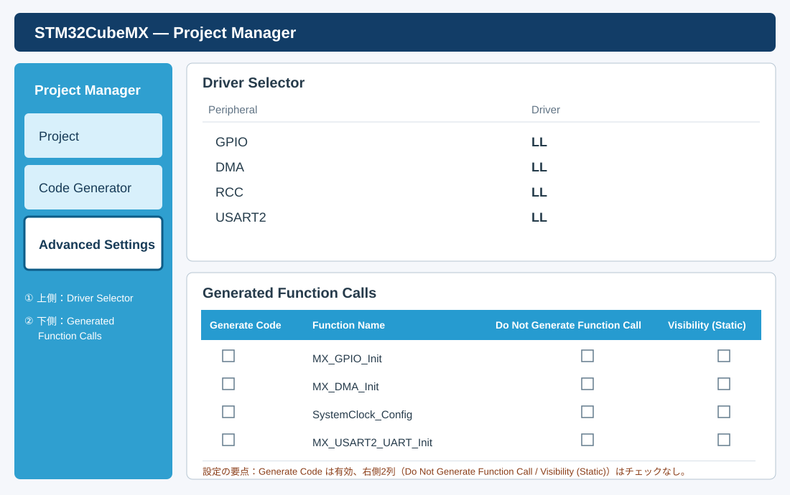

# NUCLEO-F446RE + MATLAB / Simulink R2026b 詳細セットアップ手順

この文書は、Windows 11 上で MATLAB / Simulink R2026b を使い、NUCLEO-F446RE に Simulink モデルを書き込んで実行するまでの再現手順です。

初回テストでは、基板上の緑色 LED **LD2（PA5）** を 1 秒 ON / 1 秒 OFF で点滅させます。

> **この文書の範囲**
> - 実際に今回使用した NUCLEO-F446RE の構成と設定値を記録します。
> - メニュー階層、ボタン名、入力値をできるだけ具体的に記載します。
> - 実際の `.slx` と `.ioc` ファイルは、まだこのリポジトリに添付されていません。後から追加が必要です。
> - MathWorks / ST の製品画面はリリースで変わる場合があります。画面名が少し異なる場合は、同じ機能名を探してください。

---

## 0. 全体の作業順序

### 画面・設定場所の早見表

| 目的 | 開く場所・操作 |
|---|---|
| MATLABのバージョン・製品確認 | MATLABコマンドウィンドウ → `version -release` / `ver` |
| STM32ツールの導入 | MATLABコマンドウィンドウ → `stm32setup` |
| Simulinkを開く | MATLABコマンドウィンドウ → `simulink` |
| モデル設定 | Simulinkモデル画面 → `Ctrl + E` |
| STM32ボード選択 | Model Settings → Hardware Implementation |
| CubeMXプロジェクト作成・起動 | Model Settings → Hardware Implementation → Target hardware resources → Build options → Create... / Launch... |
| CubeMXのGPIO設定 | STM32CubeMX → Pinout & Configuration |
| CubeMXのmain関数設定 | STM32CubeMX → Project Manager → Project |
| CubeMXのLL・初期化関数設定 | STM32CubeMX → Project Manager → Advanced Settings |
| Simulinkのブロック検索 | モデルキャンバスをダブルクリック、またはLibrary Browser |
| Digital Port Write | STM32 Microcontroller Blockset → STM32F4xx Based Boards |
| LED点滅モデルの書き込み | Simulinkモデル → Hardwareタブ → Build, Deploy & Start |


1. MATLAB / Simulink / STM32用製品をインストールする。
2. ライセンスとインストール済み製品を確認する。
3. `stm32setup` を実行し、STM32F4向けツールを準備する。
4. NUCLEO-F446REをUSB接続し、ST-LINKを認識させる。
5. SimulinkからSTM32CubeMXプロジェクトを作成する。
6. STM32CubeMXでPA5とコード生成設定を行う。
7. SimulinkでLED点滅モデルを作る。
8. SWD設定を行い、ビルド・書き込み・実行する。

## 1. 使用機材

- STM32 Nucleo-64: **NUCLEO-F446RE**
- MCU: **STM32F446RETx / STM32F446xx**
- CPU: ARM Cortex-M4F
- オンボードデバッガ: **ST-LINK/V2-1**
- PC: Windows 11 Pro 64-bit
- USB: データ通信対応 Mini-B USB ケーブル
- USB接続先: ボード上の ST-LINK 用端子 **CN1**

初回テストでは、外部電源、モータ、サーボ、外部センサを接続せず、ボード単体で確認します。

## 2. MATLAB製品とライセンスの確認

### 2.1 MATLABのバージョン

MATLABのコマンドウィンドウを開き、次を実行します。

```matlab
version -release
ver
```

今回の環境：

| 製品 | バージョン |
|---|---|
| MATLAB | R2026b Update 1（26.2.0.3433840） |
| Simulink | R2026b |
| MATLAB Coder | R2026b |
| Simulink Coder | R2026b |
| Embedded Coder | R2026b |
| STM32 Microcontroller Blockset | R2026b |

`ver` の一覧に上記製品が表示されることを確認します。

### 2.2 ライセンス利用可否

MATLABのコマンドウィンドウで実行します。

```matlab
license('test','MATLAB_Coder')
license('test','Real-Time_Workshop')
license('test','RTW_Embedded_Coder')
```

今回の結果はすべて `1` でした。

- `1`: そのライセンス機能が利用可能と判定された。
- `0`: 利用可能と判定されなかった。

これはライセンス利用可否の確認です。製品がインストール済みかどうかは `ver` で別途確認します。

## 3. STM32 Microcontroller Blockset のインストール

1. MATLAB上部の **Home（ホーム）** タブを開く。
2. **Add-Ons（アドオン）** を選ぶ。
3. **Get Add-Ons（アドオンを入手）** を開く。
4. 検索欄で `STM32 Microcontroller Blockset` を検索する。
5. R2026b用の製品をインストールする。
6. MATLABを再起動し、`ver` に表示されることを確認する。

## 4. STM32 Hardware Setup（`stm32setup`）

### 4.1 起動

MATLABのコマンドウィンドウで実行します。

```matlab
stm32setup
```

### 4.2 MCUファミリー選択画面

今回の選択対象は **STM32F4xx Based MCUs** です。NUCLEO-F446REのMCUであるSTM32F446RETxがSTM32F4シリーズに属するためです。


画面タイトル：**Select STM32 MCUs Family**

今回選択した項目：

- `STM32F4xx Based MCUs`

NUCLEO-F446REのMCU STM32F446REはSTM32F4シリーズです。G4など別シリーズを使わない場合は、F4だけを選択します。

### 4.3 Armclang Compiler

画面タイトル：**Armclang Compiler (Optional) のインストール**

今回の方針：

- Armclang Compilerはスキップ。
- GNU Tools for STM32を使用する。

画面右下の **Skip** をクリックします。

### 4.4 STM32CubeMX

画面タイトル：**STM32CubeMX のインストール**

今回のバージョン：

- STM32CubeMX **6.16.0**

操作：

1. 画面の **Download** をクリックする。
2. ST公式配布ページからWindows版6.16.0をダウンロードする。
3. インストーラーを実行する。
4. インストール後、Hardware Setupに戻る。
5. インストール先フォルダーを指定する。
6. **検証（Validate）** をクリックする。
7. 検証成功後、**次へ** をクリックする。

Hardware Setupでは、指定先に `STM32CubeMX.exe` が存在するフォルダーを選択します。表示される既定パスが実際のインストール先と違う場合は、**参照** から実際のフォルダーを選びます。

公式配布先：<https://www.st.com/en/development-tools/stm32cubemx.html>

### 4.5 STM32CubeProgrammer

画面タイトル：**STM32CubeProgrammer (Optional) のインストール**

今回のバージョン：

- STM32CubeProgrammer **2.22.0**

操作：

1. **Download** からWindows版をダウンロードする。
2. インストーラーを実行する。
3. Hardware Setupに戻る。
4. インストール先を指定する。
5. **検証** をクリックする。

検証対象は `STM32_Programmer_CLI.exe` を含むインストール先です。一般的には `bin` フォルダー内にCLI実行ファイルがあります。画面の説明に従い、実際のファイルが存在するパスを選択します。

公式配布先：<https://www.st.com/en/development-tools/stm32cubeprog.html>

### 4.6 STM32CubeCLT

画面タイトル：**STM32CubeCLT (Optional) のインストール**

今回のLED点滅と基本的な実機展開では使用しないため、右下の **Skip** をクリックしました。

STM32CubeCLTはCMSIS-SVDファイルなどの追加情報に関係する任意ツールです。後から必要になれば追加できます。

### 4.7 GNU Tools

Hardware Setupの案内に従ってGNU Tools for STM32を導入・登録します。

今回のビルドログでは、次のコンパイラが使用されました。

```text
GNU Tools for STM32
arm-none-eabi-gcc
arm-none-eabi-g++
```

ArmclangではなくGNU Arm Toolchainでビルドしています。

### 4.8 Hardware Setup完了後

セットアップウィザードを完了します。MATLABコマンドウィンドウに戻り、次を実行します。

```matlab
ver
```

今回の環境では、MATLAB、Simulink、MATLAB Coder、Simulink Coder、Embedded Coder、STM32 Microcontroller Blocksetが表示されました。

## 5. NUCLEO-F446REのUSB接続とジャンパ

### 5.1 USB接続

- ボードの **CN1（ST-LINK側 Mini-B USB端子）** を使用する。
- データ通信対応USBケーブルを使う。
- USBハブを避け、最初はPCに直接接続する。

### 5.2 ジャンパ確認

USBケーブルを抜いてから確認します。

| 部品 | 今回の設定 |
|---|---|
| CN2 | 2個のジャンパを両方装着 |
| JP5 | U5V側（USB給電） |
| JP6（IDD） | ジャンパ装着 |
| JP1 | OFF |

USB接続後、基板上の電源LED LD3が点灯することを確認します。

## 6. Simulinkモデルを作成する

### 6.1 新規モデル

1. MATLABのコマンドウィンドウで `simulink` と入力する。
2. Simulink Start Pageで **Blank Model** を選択する。
3. モデルを `nucleo_f446re_blink.slx` という名前で保存する。

### 6.2 Model Settingsを開く

- Simulinkモデル画面で **Ctrl + E** を押す。
- またはモデル画面の **Modeling → Model Settings** を選択する。

### 6.3 Hardware board

左側の設定ツリーで **Hardware Implementation** を選択します。

Hardware boardでSTM32F4系のターゲットを選択します。今回の画面では `STM32F4xx Based` を使用しました。

### 6.4 STM32CubeMXプロジェクトの作成場所

Model SettingsのBuild optionsには **Browse... / Create... / Launch...** の3つのボタンがあります。

- 初回は **Create...** で新しい `.ioc` を作成する。
- 作成後は **Launch...** でその `.ioc` をSTM32CubeMXで開く。
- 既存の `.ioc` を使う場合は **Browse...** で選択する。


Model Settingsの左側で次の階層を開きます。

```text
Hardware Implementation
  └─ Target hardware resources
       └─ Build options
```

Build options画面の中央付近に次のボタンがあります。

- **Browse...**: 既存のSTM32CubeMXプロジェクトを選ぶ。
- **Create...**: 新しいSTM32CubeMXプロジェクトを作る。
- **Launch...**: 選択済みプロジェクトをSTM32CubeMXで開く。

初回は **Create...** をクリックします。

### 6.5 Createで指定する内容

| 項目 | 値 |
|---|---|
| Board | NUCLEO-F446RE |
| MCU | STM32F446RETx |
| IOCファイル名 | `nucleo_f446re_blink.ioc` |
| 保存場所 | Simulinkモデルと同じ作業フォルダーを推奨 |

NUCLEO-F446REがBoard Selectorに表示される場合はそれを選びます。ボード選択ができない場合はMCU SelectorでSTM32F446RETxを選択します。

作成後、Build optionsに戻り、STM32CubeMX project file、Device id、Device familyが選択済みになっていることを確認します。

続けて **Launch...** をクリックします。

## 7. STM32CubeMXの設定

STM32CubeMXが起動すると、上部に次のタブが表示されます。

- Pinout & Configuration
- Clock Configuration
- Project Manager
- Tools

### 7.1 PA5をGPIO出力にする

1. 上部の **Pinout & Configuration** を開く。
2. MCUのピン配置図で `PA5` を探す（検索欄があればPA5で検索）。
3. PA5をクリックする。
4. メニューから **GPIO_Output** を選ぶ。

NUCLEO-F446REの緑色LED LD2はPA5に接続されています。すでにGPIO_Outputなら変更不要です。

### 7.2 Project ManagerのProject設定

1. 上部の **Project Manager** をクリックする。
2. 左側の **Project** を選ぶ。
3. 次の設定を確認する。

| 項目 | 設定 |
|---|---|
| Do not generate the main() | チェックを入れる |
| Generate under root | チェックを外す |

### 7.3 Advanced Settingsを開く

Advanced Settingsの画面構成（実際に確認した項目を図示）：



この画面では、**上側がDriver Selector、下側がGenerated Function Calls** です。左側のAdvanced Settingsを選んだ後、中央上部と中央下部をそれぞれ確認します。図は配置を説明する模式図で、実際の画面そのものではありません。


1. Project Manager画面の左側にある **Advanced Settings** をクリックする。
2. 画面上側の **Driver Selector** を確認する。
3. 画面下側の **Generated Function Calls** を確認する。

今回のAdvanced Settings画面で確認したDriver Selector：

| Peripheral | Driver |
|---|---|
| GPIO | LL |
| DMA | LL |
| RCC | LL |
| USART2 | LL |

今回の画面では、これら4項目がLLと表示されていました。別の周辺機能を追加する場合は、その機能のドライバ設定も確認します。

#### Generated Function Calls

画面下側に、次のような列を持つ表があります。

- Generate Code
- Rank
- Function Name
- Peripheral Instance
- Do Not Generate Function Call
- Visibility (Static)

今回の画面に表示された行：

- `MX_GPIO_Init`
- `MX_DMA_Init`
- `SystemClock_Config`
- `MX_USART2_UART_Init`

設定：

- **Generate Code**: 対象行でチェックあり。
- **Do Not Generate Function Call**: チェックなし。
- **Visibility (Static)**: チェックなし。

「Do Not Generate Function Call」と「Visibility (Static)」は、列見出しの下にある各行のチェック欄を確認します。今回のスクリーンショットでは全行ともチェックなしでした。

### 7.4 保存してSimulinkに戻る

1. STM32CubeMXで **Ctrl + S** を押す。
2. `.ioc` ファイルを保存する。
3. STM32CubeMXを閉じる。
4. SimulinkのModel Settingsに戻る。
5. **Apply**、続けて **OK** を押す。

通常のSimulinkビルドで必要なコード生成を行うため、この初期手順ではSTM32CubeMX画面右上の **GENERATE CODE** を別途押しません。

## 8. SimulinkのBuild options設定

Simulinkモデル画面で **Ctrl + E** を押し、次の場所を開きます。

```text
Hardware Implementation
  └─ Target hardware resources
       └─ Build options
```

今回の設定画面で使用した値：

| 項目 | 値 |
|---|---|
| Build action | Build, load and run |
| Runtime library | Reduced C |
| Floating-point ABI (-mfloat-abi) | hard |
| Floating-point expression contraction | off |
| Disable parallel build | チェックなし |
| STM32CubeMX project file | 作成した `.ioc` |
| Use custom linker file | チェックなし |
| Connectivity mode | st-link |
| Connection port | SWD |
| Frequency (kHz) | 100 |
| Mode | Under reset |
| Reset mode | Hardware reset |
| Speed | Reliable |
| Auto detect board to download and run | チェックあり |
| Generate IDE project | チェックなし |

### Flash消去の注意

初回の設定画面では **Erase all flash memory before programming** がチェックされていました。

この項目を有効にすると、書き込み前にMCUのFlash全体が消去されます。Flash内に残したいデータや別のプログラムがある場合は、チェック状態を確認してから書き込んでください。初回LEDテストでは既存プログラムを残す必要がなかったため、この設定で進めました。

## 9. Solver設定

Model Settingsの左側で **Solver** を選択します。

| 項目 | 値 |
|---|---|
| Start time | 0.0 |
| Stop time | inf |
| Type | Fixed-step |
| Solver | discrete (no continuous states) |
| Fixed-step size | 0.01 |

## 10. LED点滅モデルの作成

### 10.1 Pulse Generatorを配置

Simulinkモデルの空白部分をダブルクリックして検索欄を出し、`Pulse Generator` を検索します。

**Simulink / Sources** のPulse Generatorを配置します。

ダブルクリックして次の値を設定します。

| 項目 | 値 |
|---|---|
| Pulse type | Sample based |
| Amplitude | 1 |
| Period (number of samples) | 200 |
| Pulse width (number of samples) | 100 |
| Phase delay | 0 |
| Sample time | 0.01 |

200サンプル × 0.01秒 = 2秒周期です。100サンプル分がHighなので、1秒ON・1秒OFFになります。

### 10.2 Digital Port Writeを配置

1. モデルキャンバスの空白部分をダブルクリックするか、Library Browserを開く。
2. `Digital Port Write` と検索する。
3. 次のライブラリにあるブロックを選ぶ。

```text
STM32 Microcontroller Blockset
  └─ STM32F4xx Based Boards
       └─ Digital Port Write
```

MathWorksのR2026bブロックリファレンスでも、Digital Port WriteはSTM32F4xx Based Boardsのライブラリに掲載されています。


Simulink Library Browserを開き、検索欄で **Digital Port Write** を検索します。

STM32 Microcontroller Blocksetの **STM32F4xx Based Boards** 向けDigital Port Writeを選択します。一般的なSimulinkブロックと取り違えないように、STM32向けブロックであることを確認します。

今回の設定：

| 項目 | 値 |
|---|---|
| Port name | GPIOA |
| Pin number | 5 |
| Access port pins as array | チェックなし |

### 10.3 ブロック接続

Pulse Generatorの出力端子からDigital Port Writeの入力端子へ線を引いて接続します。

モデルの構成：

```text
Pulse Generator
      |
      v
Digital Port Write (GPIOA, Pin 5)
      |
      v
NUCLEO-F446RE LD2
```

## 11. ビルド・書き込み・実行

1. NUCLEO-F446REをCN1からPCに接続する。
2. STM32CubeProgrammerやST-Link Upgradeなど、ST-LINKを使用するアプリを終了する。
3. Simulinkモデルを **Ctrl + S** で保存する。
4. Simulink上部の **Hardware** タブを開く。
5. **Build, Deploy & Start** をクリックする。
6. コード生成、コンパイル、書き込みが完了するまで待つ。
7. LD2が1秒点灯・1秒消灯を繰り返すことを確認する。

## 12. 実際に発生した接続トラブルと解決

詳細は [troubleshooting.md](troubleshooting.md) を参照してください。要点：

- 最初のUSBケーブルではST-LINKが認識されなかった。
- データ通信対応の別USBケーブルに交換すると、ST-LINKのシリアル番号が認識された。
- ST-Link Upgrade単体版でファームウェアを更新した。
- 更新前：V2J29.M18
- 更新後：V2J49.M36
- STM32CubeProgrammerでSWD 100 kHz / Under reset / Hardware resetに設定すると、ターゲット電圧3.23 VでNUCLEO-F446REを認識し、Flashの読み出しに成功した。
- 同じ接続設定をSimulinkのBuild optionsにも設定し、最終的に実機展開に成功した。

## 13. ビルド結果

最初のコード生成・コンパイルログで確認した値：

| 項目 | 結果 |
|---|---:|
| Flash使用量 | 5,600 bytes |
| Flash容量 | 512 KB |
| RAM使用量 | 1,696 bytes |
| RAM容量 | 128 KB |

生成されたファイル：

- `nucleo_f446re_blink.elf`
- `nucleo_f446re_blink.hex`
- `nucleo_f446re_blink.bin`

初回ビルドはコード生成とコンパイルまで成功し、ST-LINK接続エラーで展開に失敗しました。USBケーブル、ST-LINKファームウェア、SWD接続設定を修正した後、ユーザー環境でSimulinkからの実機書き込みに成功しました。

## 14. 実ファイルの保存場所

このリポジトリ内では次の場所に保存します。

| ファイル | GitHub上の保存先 |
|---|---|
| Simulinkモデル | `models/nucleo_f446re_blink.slx` |
| STM32CubeMX設定 | `cubemx/nucleo_f446re_blink.ioc` |

現時点では、この2つの実ファイルはまだリポジトリに登録されていません。実際に使用したファイルをMATLAB / STM32CubeMXから保存し、別途コミットしてください。

## 15. 公式資料

- MathWorks: [Get Started with STMicroelectronics STM32 Processor Based Boards](https://www.mathworks.com/help/stm32b/ug/Getting-started-stm32cubemx.html)
- MathWorks: [Digital Port Write block reference (R2026b)](https://www.mathworks.com/help/stm32b/ref/digitalportwrite.html)
- MathWorks: [STM32 Microcontroller Blockset - System Core](https://www.mathworks.com/help/stm32b/system-core.html)
- STMicroelectronics: [STM32CubeMX](https://www.st.com/en/development-tools/stm32cubemx.html)
- STMicroelectronics: [STM32CubeProgrammer](https://www.st.com/en/development-tools/stm32cubeprog.html)
- STMicroelectronics: [ST-LINK USB driver STSW-LINK009](https://www.st.com/en/development-tools/stsw-link009.html)
- STMicroelectronics: [ST-LINK firmware upgrade utility STSW-LINK007](https://www.st.com/en/development-tools/stsw-link007.html)

## 16. この手順書の再現範囲と未登録ファイル

この手順書は、今回ユーザー環境で成功したNUCLEO-F446REのLED点滅を、同じ対象ボードとR2026b系の環境で最初から再現するためのものです。

ただし、現時点では次の実ファイルはGitHubにまだ登録されていません。

- `models/nucleo_f446re_blink.slx`
- `cubemx/nucleo_f446re_blink.ioc`

したがって、現状は手順書を読みながら新規作成する形式です。実ファイルを登録した後は、同じモデルを開いて書き込むだけの再現方法も提供できます。

## 17. 次の実験

LED点滅モデルを基準として複製し、機能を一つずつ追加します。

1. GPIO入力（USERボタン）
2. GPIO出力
3. PWM出力
4. ADC取得
5. UART通信
6. I2C通信
7. PID制御
8. EKF / 状態推定
